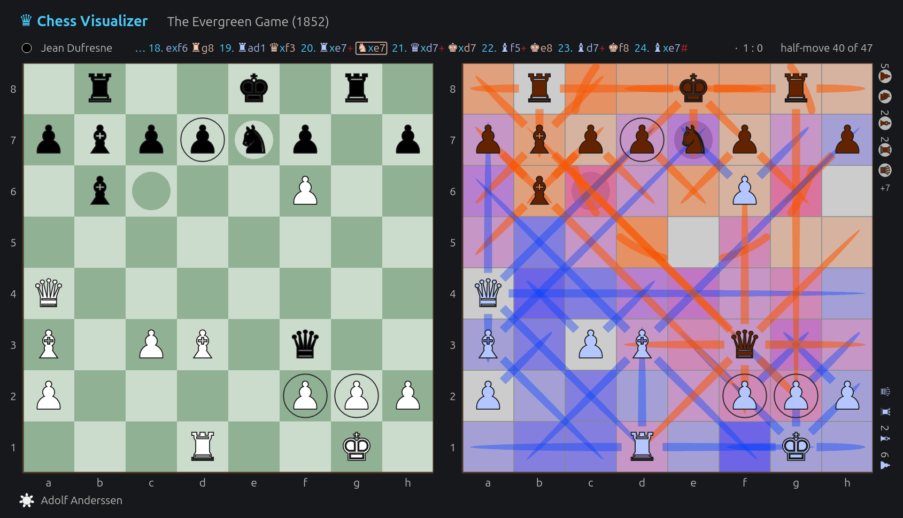
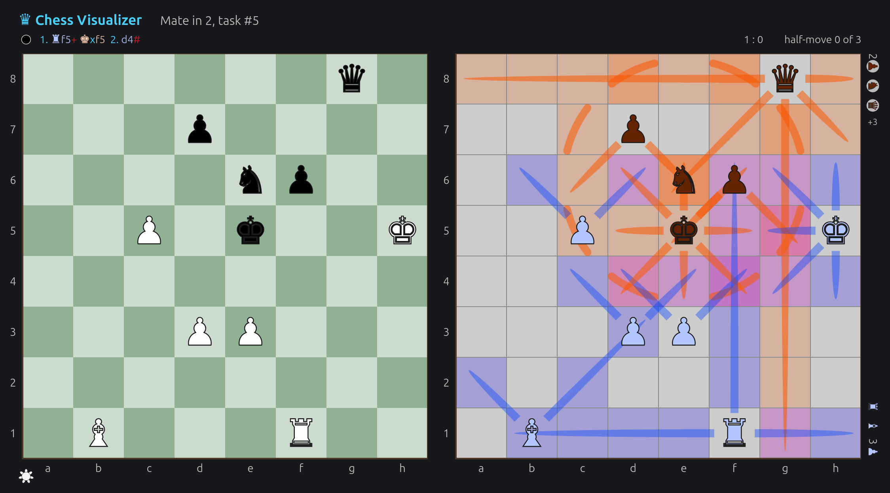
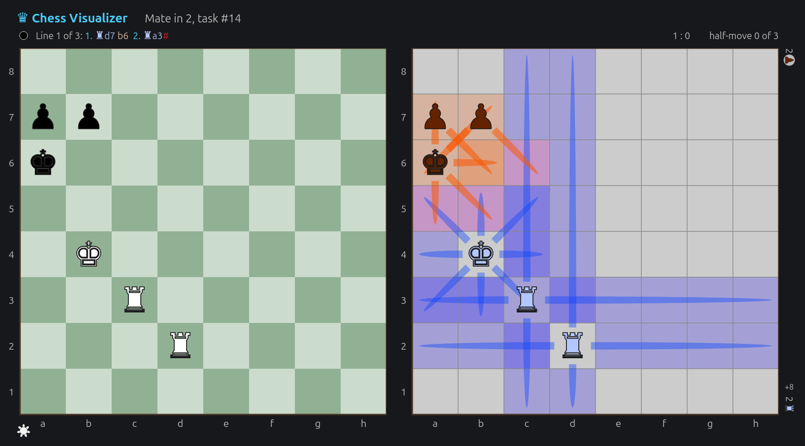

<h1></h1>

**See every attack on the board — and decide for yourself what matters. 
Let your visual intuition do the work.**

### [Try Chess Visualizer online](https://chess-visualizer.ivan-a87.workers.dev)

## Features

- **All attacks, one rule.** Every attack of every piece is visualized, as rays and a heatmap, by one straightforward algorithm. Nothing is filtered or ranked, and there's no best-move advice: what is important is for you to judge. Colors and geometry are fully configurable.
- **Two boards side by side.** A classic one next to the colored one.
- **Games with all their lines.** Browse a game and its variations move by move, or play it back, line after line. Share the whole game as a link.
- **Export animated GIF and MP4.** Record a chess task or a game, with all its lines, as an animation.
- **Play online with a friend.** No sign-up; optionally with odds or takebacks, or from a custom position.
- **Position editor.** Set up a position for a chess task.
- **Classic games.** Famous games to learn from come with the app, ready in the stash list.
- **PGN and FEN.** Import and export games with all their lines in PGN; set and read positions in FEN.

## Examples

## Development

    npm install
    npm run dev                          # the visualizer alone
    npm run build && npx wrangler dev    # ...with the two-player server
    npm test                             # unit tests
    npm run test:all-local               # unit and browser suites
    ./test-local.sh                      # two-player protocol suites

Open source under the [MIT License](LICENSE). Like it? [Support the developer ♥](https://github.com/sponsors/ivan-veselovsky).
